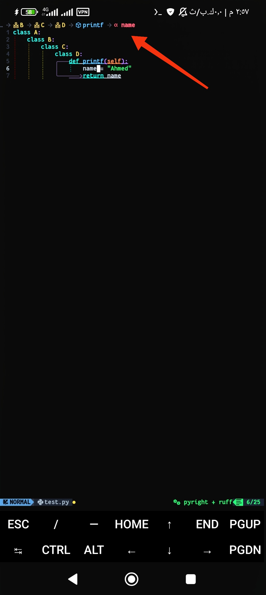
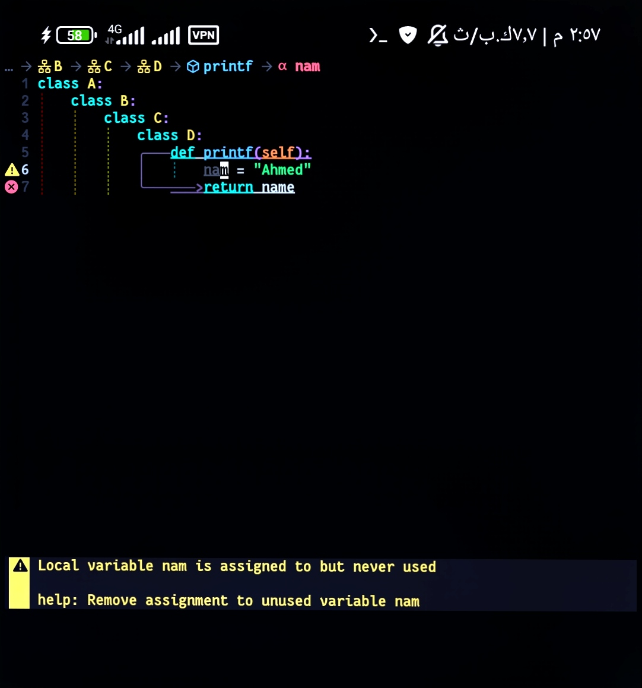
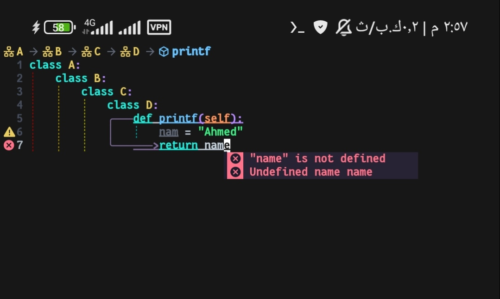
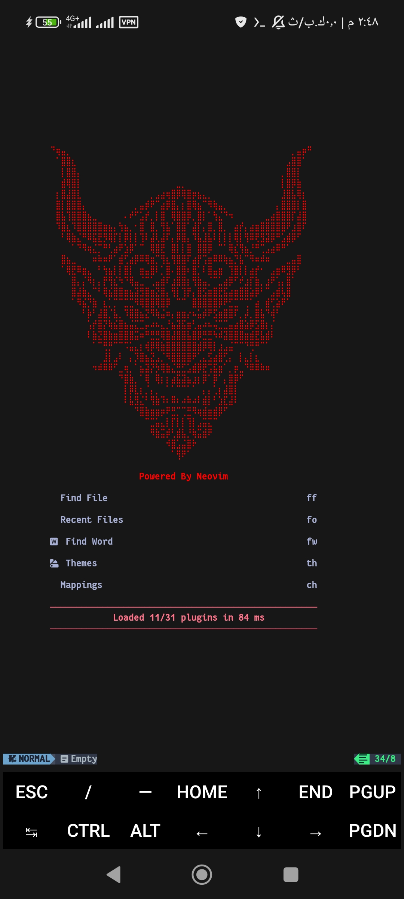
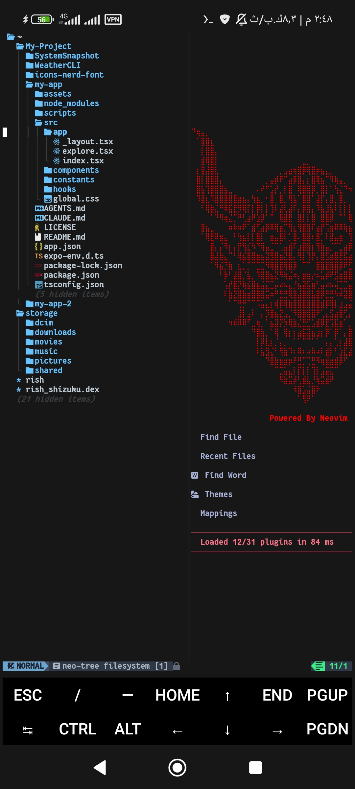

# nvim-config

My personal Neovim configuration, built on top of [NvChad v2.5](https://github.com/NvChad/NvChad) (loaded as a plugin) and designed to work on both desktop Linux and **Termux** on Android.


<details>
<summary>More screenshots</summary>





</details>

## Features

- **NvChad v2.5 base** with the `bearded-arc` theme, transparency, and a custom nvdash header.
- **`:Mason` replacement (`lua/lsp_manager.lua`)** - `mason.nvim` is disabled. Instead, a floating LSP Manager UI installs language servers, linters and formatters using the tools that already work on Termux: `pkg`, `npm` and `pip`. Inside the UI:
  - `i` / `u` install or update the tool under the cursor
  - `U` update everything installed
  - `X` uninstall (with confirmation)
  - `<CR>` expand details, `g?` help, `q` close
- **Fancy diagnostics** (vendored from [OXY2DEV/nvim](https://github.com/OXY2DEV/nvim), see `lua/scripts/`): press `D` to open a decorated floating window with the current line's diagnostics, with a beacon cursor highlight. Custom signs and severity-sorted virtual text are configured in `lua/configs/diagnostics.lua`.
- **Custom statusline modules** (`lua/configs/statusline.lua`): mode pill, file name with devicon + modified/readonly indicators, and the names of attached LSP clients.
- **Breadcrumbs** via [nvim-navic](https://github.com/SmiteshP/nvim-navic), attached on LspAttach and rendered in the winbar.
- **Plugin set**: noice.nvim (cmdline/messages UI), neo-tree (nvim-tree disabled), harpoon, trouble.nvim, diffview, conform.nvim (format on save), rainbow-indent, ts-autotag, blink snippets, markview, treesitter.
- **Run the current file** with `r` in normal mode (python, node, gcc/g++, rustc, go, bash/zsh, lua; compiled languages build into `$HOME/tmp`).

## Requirements

- Neovim **0.10+**
- git
- A [Nerd Font](https://www.nerdfonts.com/) (icons in the statusline, winbar, diagnostics and dashboard)
- Node.js + npm - most LSP servers install through npm
- Python + pip - some tools install through pip
- ripgrep - Telescope live grep
- A C compiler (`gcc`/`clang`) - treesitter parsers

On Termux:

```sh
pkg install neovim git nodejs python ripgrep clang
```

## Install

```sh
# back up any existing config first
mv ~/.config/nvim ~/.config/nvim.bak 2>/dev/null

git clone https://github.com/aelalmy45/nvim-config ~/.config/nvim
nvim
```

On the first start, lazy.nvim clones every plugin automatically. Then open `:Mason` and install the language servers you need (`i` to install).

## Layout

```
init.lua                  entry point: bootstraps lazy.nvim, loads NvChad + plugins
lua/options.lua           extra vim options
lua/mappings.lua          custom keymaps (see below)
lua/chadrc.lua            NvChad UI config: theme, nvdash, statusline, tabufline
lua/lsp_manager.lua       :Mason replacement (Termux-friendly installer UI)
lua/configs/              plugin configs (lspconfig, conform, navic, diagnostics,
                          statusline, treesitter, lazy)
lua/plugins/              plugin specs (noice, neo-tree, harpoon, trouble,
                          diffview, ts-autotag, blink-snippets, ...)
lua/scripts/              vendored from OXY2DEV/nvim: fancy diagnostics,
                          beacon cursor highlight, dynamic highlight groups.
                          Kept byte-identical to upstream for easy updates
                          (excluded from stylua via .styluaignore).
```

## Custom keymaps

Leader key is `<Space>`.

| Key | Action |
| --- | --- |
| `r` | Run the current file |
| `D` | Fancy diagnostics window for the current line |
| `]d` / `[d` | Next / previous diagnostic |
| `<Tab>` / `<S-Tab>` | Next / previous buffer |
| `<leader>x` | Close current buffer |
| `<leader>fb` | Find open buffers |
| `<leader>ha` / `<leader>hm` | Harpoon add / menu |
| `<leader>1..4` | Jump to harpoon file 1-4 |
| `<leader>gd` / `<leader>gh` / `<leader>gq` | Diffview open / file history / close |
| `<leader>dd` / `<leader>db` / `<leader>ds` / `<leader>dq` | Trouble: diagnostics / buffer diagnostics / symbols / quickfix |
| `<C-n>` | Toggle neo-tree |
| `jk` (insert) | Escape |
| `;` | Enter command mode |

Plus all the default [NvChad mappings](https://nvchad.com/docs/config/mappings).

## Development

Lua code is formatted with [stylua](https://github.com/JohnnyMorganz/StyLua) (config in `.stylua.toml`):

```sh
stylua .          # format
stylua --check .  # check, as CI does
```

`lua/scripts/` is excluded (vendored upstream code, see `.styluaignore`).

CI runs on every push and PR: a stylua check plus a headless Neovim startup check that installs all plugins from `lazy-lock.json` and verifies the config loads without errors.

## Credits

- [NvChad](https://github.com/NvChad/NvChad) - the base this config builds on
- [OXY2DEV/nvim](https://github.com/OXY2DEV/nvim) - `lua/scripts/` (fancy diagnostics, beacon, highlights)
- [LazyVim/starter](https://github.com/LazyVim/starter) - inspired NvChad's starter layout

## License

[Unlicense](LICENSE) - public domain.
